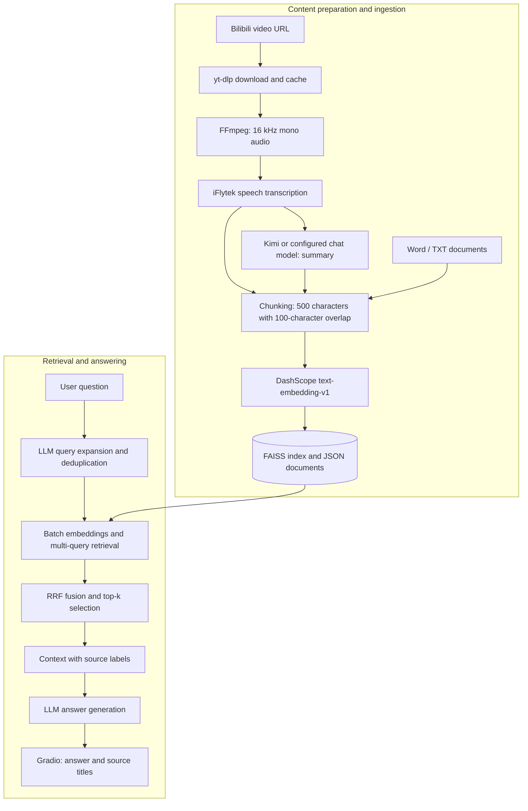

<div align="center">

# Bilibili Knowledge Assistant

### Turn videos into a knowledge base you can keep asking questions about

Transform video audio and local documents into a personal knowledge base for search, summaries, and reuse.

[简体中文](README.md) · **English**


[](https://github.com/SimonLecake/bilibili-knowledge-assistant/actions/workflows/tests.yml)

[Why this project](#why-this-project) · [Architecture](#architecture) · [Quick start](#quick-start) · [Design decisions](#key-design-decisions-and-tradeoffs) · [Limitations](#current-limitations-and-roadmap)

</div>

---

## Recorded demo

**04:05** · Play inline or use the player's fullscreen control.

Start with a video URL, follow download and transcription, inspect the summary and ingestion result, then ask a knowledge-base question and review the answer and sources.

https://github.com/user-attachments/assets/9920a8df-6ac5-4cde-8612-86511bfe3530

**Approximate chapters:** `00:00` URL and content processing · `01:45` Transcript and summary · `02:00` Knowledge-base question · `03:40` Answer and sources

<details>
<summary>Expand a screenshot from the recording</summary>


Captured from the author-provided recording. The application interface is in Chinese.

</details>

Processing waits and the answer's evidence limitations are retained. Third-party video content and model-generated text demonstrate the processing workflow; they are not endorsed factual claims or a QA-quality benchmark.

## Why this project

Saved videos are easy to accumulate and hard to revisit. When you need a particular idea, finding the right moment can mean watching the video again. A summary helps with browsing, but answering a question that spans several videos and notes requires a way to retrieve and combine their content.

This project connects **content acquisition → transcription and summarization → persistent storage → on-demand questions**, bringing courses, interviews, practical advice, and personal notes into one retrieval workflow. Bilibili is the video platform supported by the current ingestion pipeline.

| Use case | How the application helps |
| --- | --- |
| Get the main ideas from a long video | Extract audio, transcribe speech, and generate a summary and Word report |
| Find an idea encountered earlier | Persist transcripts and summaries for semantic search |
| Use course material alongside personal notes | Ingest video content and Word / TXT documents into the same knowledge base |
| Compare approaches across several sources | Retrieve with multiple queries, fuse rankings, and generate an answer with source labels |

**Status: a personal knowledge-base application prototype.** The ingestion and question-answering workflows are implemented and supported by offline regression tests. Production multi-user operation and independently validated answer-quality metrics are outside the current scope.

## Features

- **Video analysis:** download a Bilibili video with yt-dlp, extract its audio with FFmpeg, transcribe it with iFlytek, and summarize it with an LLM.
- **Authentication and caching:** try browser cookies from Firefox, Edge, and Chrome in that order, or accept an uploaded JSON / Netscape TXT cookie file. Cache video and audio by Bilibili BV video ID.
- **Document ingestion:** import `.docx` and `.txt` files with an optional title and source identifier.
- **Persistent knowledge base:** store metadata, original transcripts, and generated summaries as separate chunks, backed by a local FAISS index and JSON files.
- **Retrieval-augmented answers:** embed the original question and up to three expanded queries in a batch, then select context using Reciprocal Rank Fusion (RRF).
- **Output:** show answers and source titles in the interface; save video transcripts and summaries as TXT files and a Word report.
- **Source updates:** replace the chunks and vectors for an existing source when it is ingested again; normalize Bilibili URLs to remove tracking parameters.

## Architecture



| Layer | Technology | Responsibility |
| --- | --- | --- |
| Interface | Gradio Blocks | Three tabs for video analysis, document ingestion, and knowledge-base questions |
| Orchestration | Python, generators, Requests | Fixed workflow, progress updates, transcription polling, and LLM timeout retries |
| Content processing | yt-dlp, FFmpeg, python-docx | Acquire video audio, parse documents, and export reports |
| Model services | iFlytek, Moonshot, DashScope | Speech recognition, text generation, and embeddings |
| Retrieval | NumPy, FAISS IndexFlatIP | Search normalized vectors and persist the local index |
| Ranking fusion | RRF in plain Python | Combine query rankings, deduplicate chunks, and enforce the context budget |

Python controls the workflow, while models expand queries and generate text. The application implements RAG directly, without LangChain or an autonomous tool-calling agent.

## Quick start

### 1. Install

Publication checks used **Python 3.11**. Use a dedicated virtual environment.

```bash
git clone https://github.com/SimonLecake/bilibili-knowledge-assistant.git
cd bilibili-knowledge-assistant
python -m venv .venv
```

Activate the environment:

```powershell
# Windows PowerShell
.\.venv\Scripts\Activate.ps1
```

```bash
# macOS / Linux
source .venv/bin/activate
```

```bash
python -m pip install -r requirements.txt
```

### 2. Configure services

Copy `.env.example` to `.env` and fill in your configuration:

```powershell
# Windows PowerShell
Copy-Item .env.example .env
```

```bash
# macOS / Linux
cp .env.example .env
```

| Setting | Purpose | Required for |
| --- | --- | --- |
| `XFYUN_APPID`, `XFYUN_API_SECRET` | iFlytek audio transcription | Video analysis |
| `DASHSCOPE_API_KEY` | Document and query embeddings | Knowledge-base ingestion and retrieval |
| `LLM_API_KEY`, `LLM_MODEL` | Summaries, query expansion, and answers | Generative features |
| `LLM_API_URL` | Chat Completions endpoint | Defaults to Moonshot; a compatible service can be configured |
| `FFMPEG_PATH` | FFmpeg executable | Optional; otherwise use PATH, then the binary bundled with imageio-ffmpeg |
| `GRADIO_SERVER_PORT` | Web server port | Optional; defaults to `7860` |

`LLM_MODEL` has no hardcoded default. Set it to a model available to your service account. To switch providers, update the endpoint, model name, and API key together, and verify compatibility.

**Data flow:** audio is sent to iFlytek; ingested text and questions are sent to DashScope; transcripts or retrieved passages are sent to the configured LLM service. Storage is local, but processing depends on cloud APIs, which may incur charges.

### 3. Launch

```bash
python bilibili_analyzer.py
```

Open **http://127.0.0.1:7860**. The server listens on localhost by default.

To try document questions first, configure only DashScope and the LLM. Bilibili cookies and an iFlytek account are not needed for that workflow.

The current application interface, built-in prompts, and sample documents are in Chinese. This README provides English setup instructions and an overview of the implementation.

### 4. Try a small demo

1. In **Document Ingestion (文档沉淀)**, upload [`examples/learning_notes.txt`](examples/learning_notes.txt) and [`examples/project_notes.txt`](examples/project_notes.txt). Both are manually written demonstration materials.
2. In **Knowledge-Base Q&A (知识库问答)**, set the maximum number of source chunks to `4`.
3. Ask: **“如何把课程复盘与动手做项目结合起来？”** — “How can I combine reviewing course material with hands-on projects?”
4. Check whether the answer draws on methods from both sources. Upload the same file again and verify that the knowledge-base size stays stable.

For video analysis, use a single Bilibili BV video URL that you have permission to process. If browser cookie extraction fails, upload an exported cookie file. Platform changes can affect the downloader; if URL extraction fails, try updating `yt-dlp` in your virtual environment.

## Key design decisions and tradeoffs

### 1. Index original text, summaries, and metadata separately

Transcripts preserve detail, summaries provide an overview, and titles and other metadata help identify topics. Each chunk retains its source, title, and content type. Source labels are included in the prompt to help the model keep information attributed to the correct document. Generated summaries can still contain errors, so important claims should be checked against the original material.

### 2. Fuse query results before applying the context limit

Concatenating results in query order and taking the first k chunks can fill the context entirely with matches from the original question. Evidence found by expanded queries may then be discarded.

The current implementation deduplicates the original and expanded questions, embeds them in a batch, and combines their retrieval rankings using `score(chunk) = Σ 1 / (60 + rank)`. It selects the final top-k chunks only after fusion. This lets expanded queries contribute to evidence selection. RRF scores are ranking weights, not answer-confidence estimates.

### 3. Keep storage lightweight and local

FAISS `IndexFlatIP` performs exact inner-product search over normalized vectors, giving the same ordering as cosine similarity. JSON files store text and source metadata for inspection and migration, without a separate database service.

The tradeoff is an in-memory index with linear-scan retrieval. Updating a source rebuilds the index while reusing vectors from other documents. This approach targets small personal knowledge bases; large-scale concurrent writes require a different storage design.

### 4. Bound context size and service calls

The default query flow consists of one query-expansion call, one batch query-embedding call, and one answer-generation call. If expansion fails, it falls back to the original question. Each context chunk is limited to 500 characters, and the interface controls the final number of chunks.

LLM document routing based on titles remains an experimental option and is disabled by default to avoid an additional sequential model call. The project does not yet have a reliable end-to-end latency or cost benchmark and makes no fixed response-time claim.

## Code guide

```text
.
├── bilibili_analyzer.py       # Gradio UI, video pipeline, and answer generation
├── bilibili_kb.py             # Chunking, embeddings, indexing, source updates, persistence
├── retrieval.py               # Query deduplication and RRF ranking fusion
├── settings.py                # Environment configuration and FFmpeg discovery
├── .env.example               # Configuration template without credentials
├── requirements.txt           # Runtime dependencies
├── examples/                  # Manually written, publishable demo materials
├── tests/                     # Regression tests without external API calls
├── docs/evaluation.md         # Evaluation approach and manual checks (Chinese)
└── .github/workflows/tests.yml
```

Generated `kb_data/`, `video_cache/`, cookie files, `.env`, and reports are excluded from Git. An explicit publication allowlist keeps historical experiments and private materials out of the public repository.

## Testing and evaluation

```bash
python -m unittest discover -s tests -v
```

Offline tests use temporary knowledge bases and mocked embeddings. They cover multi-query fusion, source replacement, index reloads, preservation of existing vectors, and failure handling. GitHub Actions runs the same tests on Python 3.11.

These tests verify application behavior, not model answer accuracy. Quantitative evaluation requires independently labeled questions, actual evidence passages, and questions that the knowledge base cannot answer. The [evaluation guide (Chinese)](docs/evaluation.md) describes that approach. Private datasets and historical model self-scores are excluded from the public repository; self-scores are not presented as accuracy metrics.

## Current limitations and roadmap

| Current limitation | Planned direction |
| --- | --- |
| Processes spoken content, without understanding video frames, slides, or screen actions | Preserve timestamps; explore keyframes and OCR |
| Shows source titles without clickable original evidence | Display evidence passages and video timestamp links |
| Vector retrieval has no relevance threshold; handling insufficient evidence depends on prompts and the model | Build a labeled set; evaluate answerability checks, hybrid search, and rerankers |
| Single-turn questions without conversation memory | Add controlled follow-up context |
| File storage lacks inter-process locks and cross-file transactions | Introduce a task queue, persistent job state, and concurrency controls |
| Video and audio caches are keyed by BV ID | Improve multipart video and short-link handling; add transcription caching |
| Word ingestion reads body paragraphs only | Parse tables and richer document structures |
| Long videos are uploaded and summarized as a whole | Segment audio and summarize long transcripts hierarchically |

Existing knowledge bases from older versions are not automatically deduplicated in full. Re-ingesting a source replaces its indexed content. To fully normalize historical data, back it up and rebuild in a new directory.

## What this project demonstrates

The project covers the path from unstructured content acquisition to a usable RAG application: **integrating external services, designing retrieval strategies, maintaining data consistency, building an interactive workflow, and distinguishing regression checks from answer-quality evaluation.**

Future work focuses on three outcomes: **retrieve more relevant evidence, make answers easier to verify, and keep the knowledge base reliable as it grows.**
