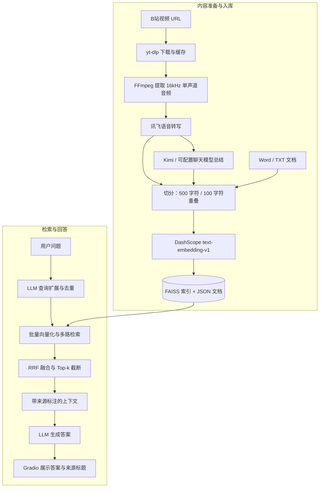

<div align="center">

# Bilibili Knowledge Assistant

### B 站视频知识库 · 从一次观看，到反复提问

把视频音轨和本地文档转化为可检索、可总结、可复用的个人知识库。

**简体中文** · [English](README.en.md)


[](https://github.com/SimonLecake/bilibili-knowledge-assistant/actions/workflows/tests.yml)

[项目价值](#为什么做这个项目) · [技术架构](#技术架构) · [快速开始](#快速开始) · [工程取舍](#关键设计与工程取舍) · [能力边界](#当前边界与后续计划)

</div>

---

## 为什么做这个项目

收藏的视频越来越多，真正需要某个观点时，却常常想不起它在哪里；视频摘要能够帮助快速浏览，但很难直接回答一个横跨多份资料的问题。

这个项目将 **“获取内容 → 理解内容 → 沉淀资料 → 按需提问”** 连接起来，让课程、访谈、经验分享和个人笔记进入同一个检索流程。

| 使用场景 | 应用提供的帮助 |
| --- | --- |
| 一段长视频，想先了解核心内容 | 提取音轨、语音转写、生成要点总结和 Word 报告 |
| 曾经看过某个观点，想重新查找 | 将原始转写与总结持久化，支持语义检索 |
| 想把课程内容和自己的笔记一起使用 | 视频资料与 Word / TXT 文档统一入库 |
| 想比较多份资料中的方法 | 多查询召回、排序融合、来源标注和综合回答 |

**项目状态：个人知识库应用原型。** 已实现端到端工作流和离线回归测试；尚未提供生产级多用户服务或经过独立标注验证的质量指标。

## 功能一览

- **视频分析**：输入 B 站链接，通过 yt-dlp 下载，FFmpeg 提取音频，调用讯飞转写与 LLM 总结。
- **登录态与缓存**：依次尝试 Firefox、Edge、Chrome 的 Cookies，也可上传 JSON / Netscape TXT；按 BV 号缓存视频与音频。
- **文档入库**：支持 `.docx` 和 `.txt`，可指定标题与来源标识。
- **持久化知识库**：分别存储元数据、原始转写、生成摘要，使用本地 FAISS 索引与 JSON 文件。
- **检索增强问答**：原问题与最多三个扩展查询批量向量化，通过 RRF 融合后选择上下文。
- **结果输出**：界面展示回答与来源标题；视频分析另保存 TXT 和 Word 报告。
- **重复来源更新**：同一来源再次入库会替换对应文本块与向量，B 站链接会去除常见追踪参数。

## 技术架构



| 模块 | 技术 | 职责 |
| --- | --- | --- |
| 交互层 | Gradio Blocks | 视频分析、文档沉淀、知识库问答三个标签页 |
| 编排层 | Python、生成器、Requests | 固定流程编排、进度反馈、转写轮询、LLM 超时重试 |
| 内容处理 | yt-dlp、FFmpeg、python-docx | 获取视频音轨、解析文档、输出报告 |
| 模型服务 | 讯飞、Moonshot、DashScope | 语音识别、文本生成、Embedding |
| 检索层 | NumPy、FAISS IndexFlatIP | 归一化向量检索与本地持久化 |
| 排序融合 | 原生 Python RRF | 合并不同查询的排名，去重后控制上下文预算 |

这是由代码编排的 RAG 应用。模型负责扩展问题和生成文本，流程控制在 Python 中；未引入 LangChain 或自主工具调用 Agent。

## 快速开始

### 1. 安装

本地发布检查使用 **Python 3.11**。建议使用独立虚拟环境。

```bash
git clone https://github.com/SimonLecake/bilibili-knowledge-assistant.git
cd bilibili-knowledge-assistant
python -m venv .venv
```

激活虚拟环境：

```powershell
# Windows PowerShell
.\.venv\Scripts\Activate.ps1
```

```bash
# macOS / Linux
source .venv/bin/activate
```

```bash
python -m pip install -r requirements.txt
```

### 2. 配置服务

复制 `.env.example` 为 `.env`，填入自己的配置：

```powershell
# Windows PowerShell
Copy-Item .env.example .env
```

```bash
# macOS / Linux
cp .env.example .env
```

| 配置 | 用途 | 何时需要 |
| --- | --- | --- |
| `XFYUN_APPID`、`XFYUN_API_SECRET` | 讯飞音频转写 | 分析视频 |
| `DASHSCOPE_API_KEY` | 入库和查询向量化 | 使用知识库 |
| `LLM_API_KEY`、`LLM_MODEL` | 总结、查询扩展、回答 | 使用生成能力 |
| `LLM_API_URL` | Chat Completions 接口地址 | 默认 Moonshot，可自行配置兼容服务 |
| `FFMPEG_PATH` | FFmpeg 可执行文件 | 可选；优先使用 PATH，其次使用 imageio-ffmpeg 自带程序 |
| `GRADIO_SERVER_PORT` | Web 端口 | 可选，默认 `7860` |

`LLM_MODEL` 没有写死为某个型号，请填写你的服务账号实际可用的模型名称。更换服务需要同时修改地址、模型名与密钥，兼容性需自行验证。

**数据流向：** 音频会发送给讯飞；入库文本和问题会发送给 DashScope；转写内容或检索片段会发送给配置的 LLM 服务。本地存储不等于全离线处理，外部服务可能产生费用。

### 3. 启动

```bash
python bilibili_analyzer.py
```

打开 **http://127.0.0.1:7860**。默认仅监听本机。

如果先体验文档问答，只需配置 DashScope 与 LLM，无需 B 站 Cookies 或讯飞账号。

### 4. 运行一个小演示

1. 打开“文档沉淀”，上传 [`examples/learning_notes.txt`](examples/learning_notes.txt) 和 [`examples/project_notes.txt`](examples/project_notes.txt)。这些是人工编写的演示资料。
2. 打开“知识库问答”，将参考片段数设为 `4`。
3. 提问：**“如何把课程复盘与动手做项目结合起来？”**
4. 核对回答是否引用了两份资料中的方法，再重复上传同一文件，检查知识库规模保持稳定。

视频分析时，请使用有权处理的单个 B 站 BV 视频链接。浏览器 Cookies 读取失败时，可手动上传导出的 Cookies 文件。下载器受平台变更影响，遇到解析错误可在虚拟环境中更新 `yt-dlp` 后重试。

## 关键设计与工程取舍

### 1. 原文、摘要与元数据分别入库

原始转写保存细节，摘要提供概括，标题等元数据帮助识别主题。每个片段保留来源、标题和类型，组织 Prompt 时带上来源归属，减少把 A 资料的观点归给 B 资料的情况。生成摘要仍可能出错，关键结论需要回到原文核对。

### 2. 用 RRF 融合多查询结果

直接按查询顺序拼接结果再取前 k 条，会让原问题结果占满上下文，扩展查询即使召回新证据也可能被丢弃。

当前先对原问题和扩展问题去重、批量 Embedding，再按每组检索中的排名累加 RRF 分数：`score(chunk) = Σ 1 / (60 + rank)`，最终才截取 Top-k。这样扩展查询能够参与最终证据选择。RRF 分数是排序权重，不是答案置信度。

### 3. 选择轻量的本地存储

FAISS `IndexFlatIP` 对归一化向量进行精确内积检索，效果等价于余弦相似度排序。JSON 保存文本及来源，便于查看和迁移，无需额外部署数据库。

代价是索引驻留内存，查询为线性扫描；更新来源时重建索引并复用其他资料的向量。该方案适合个人小型知识库，暂不面向大规模并发写入。

### 4. 控制上下文与服务调用

默认使用一次查询扩展、一次批量查询 Embedding 和一次答案生成；扩展失败时回退到原问题。单片段最多传入 500 字符，界面可调整最终片段数。

基于标题的 LLM 文档路由作为实验选项保留，默认关闭，避免额外串行模型调用。当前没有可靠的端到端延迟或费用基准，因此不宣称固定响应时间。

## 代码导航

```text
.
├── bilibili_analyzer.py       # Gradio 界面、视频流水线、问答入口
├── bilibili_kb.py             # 切分、Embedding、索引、来源替换与持久化
├── retrieval.py               # 查询去重与 RRF 排序融合
├── settings.py                # 环境配置与 FFmpeg 发现
├── .env.example               # 无密钥配置模板
├── requirements.txt           # 运行依赖
├── examples/                  # 可公开的人工演示资料
├── tests/                     # 无外部 API 的回归测试
├── docs/evaluation.md         # 评估方法与手动验证步骤
└── .github/workflows/tests.yml
```

运行后生成的 `kb_data/`、`video_cache/`、Cookies、`.env` 和报告均不进入 Git。仓库采用明确的发布文件白名单，历史实验脚本和私人语料不属于公开版本。

## 验证与评估

```bash
python -m unittest discover -s tests -v
```

离线测试使用临时知识库和模拟 Embedding，覆盖多查询融合、重复来源替换、索引重载、向量保留及异常处理。GitHub Actions 在 Python 3.11 上执行同一组测试。

这些测试验证工程行为，不能证明模型回答准确率。量化评估需要独立标注的问题、实际证据片段和拒答样本；具体方案见 [评估说明](docs/evaluation.md)。公开版本未附带个人语料和历史自评分，也未将自评分换算成准确率。

## 当前边界与后续计划

| 当前边界 | 后续方向 |
| --- | --- |
| 分析音轨文本，不理解画面、PPT 或屏幕操作 | 时间戳保留、关键帧与 OCR |
| 来源展示以标题为主，缺少可点击的原文证据 | 证据片段展示、视频时间跳转 |
| 向量检索没有相关性阈值，拒答依赖提示词与模型 | 标注集、无答案判断、混合检索与 Reranker 对比 |
| 单轮问答，不保存对话记忆 | 可控的追问上下文 |
| 文件存储缺少跨进程锁和跨文件事务 | 任务队列、持久化任务状态、并发一致性 |
| 视频/音频缓存目前按 BV 号区分 | 完善分 P 与短链接处理、转写缓存 |
| Word 导入目前只读取正文段落 | 表格与更丰富文档结构解析 |
| 长视频整段上传、整段总结 | 音频分段、长文本分层总结 |

对已有旧版本知识库，本版本不会自动全库清理历史重复记录；重新入库会替换对应来源的索引内容。若需完全统一历史数据，建议备份后在新目录重建。

## 项目实践重点

这个项目展示了从非结构化内容获取到 RAG 应用交付的完整实践：**多服务集成、检索策略设计、数据一致性处理、交互流程实现，以及对效果评估边界的明确区分。**

后续改进优先围绕三个目标：**找到更相关的证据、让回答可以核验、让知识库能够稳定积累。**
